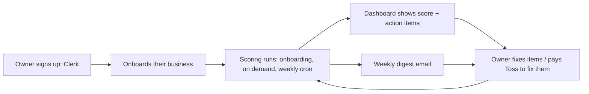

# Product: Visibility OS

- **Package:** `@toss/visibility-os` at `apps/visibility-os`
- **Status:** In development. Phase 1 (auth, onboarding, dashboard shell, data model) is built and deployed. Scoring v1, including live Google data and a weekly re-score cadence, runs entirely in-app (ADR-0007, ADR-0009, ADR-0010); the standalone `@toss/visibility-agent` package remains future work for model-written copy and attributable runs.
- **Job:** show a local business owner exactly how visible they are online and exactly what to do next, on a subscription.

## The core loop (target)

The product is the loop, not the dashboard. The dashboard only renders the loop's state.

## What exists today (verified against code, updated 2026-09-23)

- Clerk sign-in/sign-up, onboarding, dashboard, businesses page, business detail page (`/businesses/[id]`), settings page.
- **Scoring v1 (live):** deterministic audit in `lib/scoring.ts`. Website checks (reachable, HTTPS, title, meta description, mobile viewport, response time, no external API key needed). Google presence via a real Places API (New) lookup at onboarding (search, verified `googlePlaceId`, phone, category, city) plus live `reviewCount`/`avgRating` — see [ADR-0009](../01-architecture/decisions/0009-google-places-api-for-live-google-data.md). Social presence (Instagram handle). Weights: Google 40%, website 40%, social 20%. Runs after onboarding, on demand via the dashboard audit buttons, and weekly for every business via a Vercel Cron job (`GET /api/cron/weekly-score`) — see [ADR-0010](../01-architecture/decisions/0010-weekly-rescore-cron-and-digest.md).
- **Action items (live):** every failed check generates a plain-language recommendation with priority (HIGH/MEDIUM/LOW) and category; open PENDING items are regenerated on each audit, IN_PROGRESS and DONE are preserved.
- **Weekly digest email (live):** every business owner gets one email a week, unconditionally, via `@toss/email` (Resend). Leads with what changed (score, review count, or rating movement) when something did, otherwise with the single highest-priority open action item — never a "nothing happened" message. See ADR-0010.
- API: businesses CRUD (Zod-validated), score route, cron route (`CRON_SECRET`-gated), Clerk webhook handler (Svix-verified; secret not yet configured in prod as of this writing). Until it is, the lazy user-upsert in `POST /api/businesses` creates the user with their real email from Clerk (`currentUser()`), falling back to a per-user placeholder, never a shared blank that would collide on the unique `email` column. Users created before that fix have a blank email and get no digest; `scripts/backfill-user-emails.ts` fixes them once the secret is configured.
- Website audit: redirects are followed hop by hop under the SSRF guard (see [security.md](../01-architecture/security.md)) within one 8s budget; meta tags are parsed by attribute, so unquoted values and any attribute order are recognised.
- Data: Supabase Postgres via the Vercel integration (`POSTGRES_PRISMA_URL` for queries, `POSTGRES_URL_NON_POOLING` for migrations), committed baseline migration, `prisma migrate deploy` in the Vercel build. See [ADR-0007](../01-architecture/decisions/0007-supabase-postgres-and-in-app-scoring-v1.md).
- Runs on port 3001 locally.

## What does not exist yet

- Full review content and drafted/posted replies: Places API Details only returns a review count and rating, not the review list or a reply channel. Needs Google's Business Profile API, which needs manual Google approval, a verified profile active 60+ days, and owner OAuth — an owner-driven external process. Next slice once that access exists.
- Competitor movement tracking — needs its own data model and UI; a future slice.
- Paid plans: the `Plan` enum has FREE; paid tiers, limits, and Flutterwave billing are undecided.
- Action item status toggling in the UI.

## Product decisions pending (each blocks specific work)

| Decision | Blocks |
|---|---|
| Plan tiers, limits, pricing | billing work, re-score cadence |
| Score cadence per tier (everyone gets weekly today; should paid tiers get more?) | billing work |
| NG-only vs multi-country at launch | copy, plan pricing currency |

## Success metrics (once live)

Signups, businesses onboarded, weekly active owners, action items completed, free-to-paid conversion.
